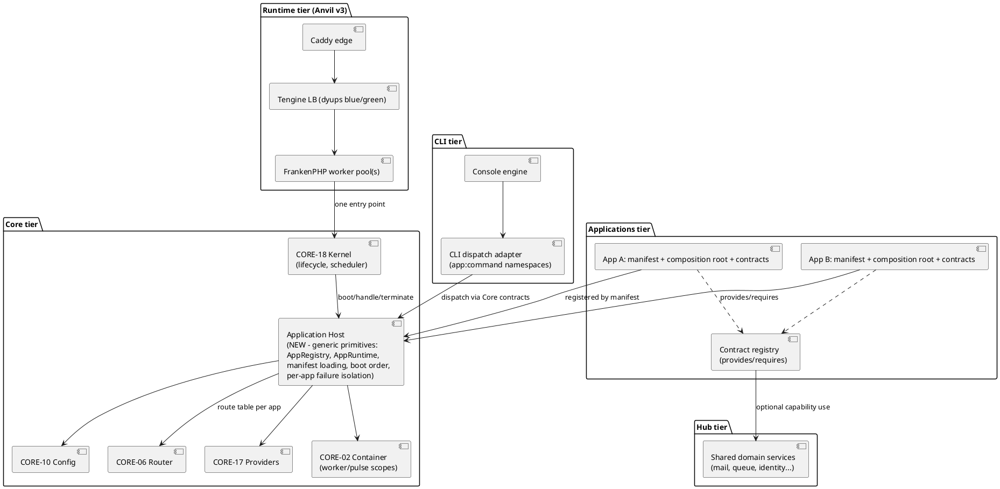
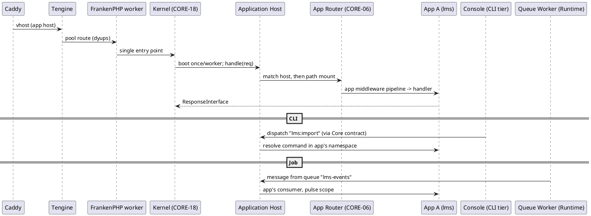

# SStack Independent Architecture Assessment — Application Hosting Platform

**Assignment:** Independent architectural assessment of SovereignStack (SStack) as a PHP application hosting platform
**Mode:** READ-ONLY investigation — no implementation authorised
**Date:** 2026-11-27
**Author:** Z.ai (independent assessment per §8 Independent Review Protocol)
**Standing instruction applied:** Report published through a pull request to the SStack repository

**Product vision under assessment:**

> SStack should provide an accessible, disciplined platform capable of hosting multiple PHP applications, whether independently operated, isolated, or intentionally integrated. It should make good architectural decisions easy and undesirable dependencies difficult, without imposing unnecessary architectural ceremony.

---

## How to read this report

Every claim is tagged with an evidence classification:

| Tag | Meaning |
|---|---|
| **REPOSITORY-VERIFIED** | Confirmed directly from SStack repository / git state |
| **SOURCE-VERIFIED** | Confirmed directly from DGLab source code at baseline `543329ed` |
| **DOCUMENT-VERIFIED** | Confirmed from an authoritative DGLab architecture document (ADR, blueprint, spec) |
| **INFERRED** | Reasonable interpretation of verified evidence; not explicitly established |
| **PROPOSED** | Recommendation of this assessment awaiting owner decision |
| **UNVERIFIED** | Could not be confirmed |

Per §8 of the assignment: this assessment was derived **independently**, starting from repository evidence and the product vision. Prior AI proposals (Mistral, ChatGPT) were NOT used as the starting architecture. A comparison against prior proposals appears only in §15, after the independent assessment, and is limited by what could be located (see §15.1).

---

# 1. Executive Summary

## 1.1 The single most important finding

**Verified DGLab — the reconstruction reference — hosts exactly ONE application per installation.** The DGLab source tree contains a single application composition root (`app/ApplicationFactory.php`, SOURCE-VERIFIED, 432 lines) which wires one application (the DGLab app itself, with its LMS and Manga spokes) into one Kernel, one Container, one Router. There is **no application registry, no multi-application dispatch, and no per-application lifecycle machinery anywhere in the DGLab source** (SOURCE-VERIFIED via full-tree inspection of `app/`, Core, and orchestrator).

The product vision — hosting *multiple* applications, independently operated, isolated, or integrated — is therefore **not a reconstruction of DGLab architecture; it is a new capability that extends beyond it.** This has governance consequences: OD-007 requires components be reconstructed one at a time from verified requirements, and the multi-app platform has no DGLab blueprint to reconstruct from. The capability must be **designed and owner-ratified as new architecture**, not reconstructed.

This is not a defect of the vision — it is a scope clarification the owner must make consciously. The rest of this assessment designs the capability on that explicit basis.

## 1.2 The recommended direction (summary)

1. **Define "application" as a manifest-declared composition unit** — unique identity, own composition root, own configuration namespace, own routes/commands/queue consumers, own container scope, and explicit `provides`/`requires` contracts. (§3, §4)
2. **Build hosting on existing approved primitives, not new ones**: CORE-18 Kernel lifecycle, CORE-17 Service Providers, CORE-02 worker/pulse container scopes, CORE-10 TOML config, CORE-06 Router, Anvil runtime substrate. A thin, generic **Application Host capability** orchestrates these; it does not replace them. (§3)
3. **Adopt a three-tier honesty ladder for isolation**: same-process (logical isolation only — *not* a security boundary), per-process (FrankenPHP worker pools per application), independent deployment (separate installations/containers). State guarantees explicitly; never claim namespace or container separation is security isolation. (§5)
4. **Cross-application integration only through declared, versioned contracts** resolved at boot — never direct imports between applications. This reuses the DGLab Bridge/ContractRegistry pattern. (§6)
5. **Entry points converge on a single dispatch spine**: HTTP (host-then-path multiplexing), CLI (`app:command` namespacing), jobs (per-application queue routing) all reach applications through the Application Host, not through tier-specific ownership. (§7)
6. **Progressive developer experience**: a minimal application is one `app.toml` manifest plus one composition-root class — no mandatory MVC/DDD/Hexagonal, no forced directory ceremony. Forge (OD-005) scaffolds it. (§9)
7. **Roadmap placement requires an owner decision**: the Application Host capability is *new Core-tier work* (no DGLab blueprint exists); it should queue after CORE-17/CORE-18 within Stage 1, or be deferred to a new stage — the owner must decide, because either choice changes the approved roadmap. (§12, §13)

## 1.3 Conflicts with existing approved decisions

Two items require explicit owner resolution (detail in §4.6, §13):

- **C-A (roadmap insertion):** any new Core-tier "Application Host" component inserts work into the approved Stage 1 sequence (OD-006/OD-007 discipline). Not silently changeable.
- **C-B (scope beyond DGLab reconstruction):** the multi-app capability has no DGLab blueprint; "faithful reconstruction" (the governing principle) does not cover it. Ratifying new architecture requires the owner to explicitly extend the mission.

No conflict exists with the tier boundary rules themselves (Core↛CLI, CLI↔Hub independence, OD-009 sequencing) — the design below respects all of them.

---

# 2. Verified Assessment of the Existing SStack Architecture

## 2.1 SStack repository state (REPOSITORY-VERIFIED, inspected 2026-11-27)

| Item | State |
|---|---|
| SStack `main` | `bce2f436` — initial commit only; a README. **No framework implementation is merged.** |
| PR #3 `feature/core-10-config` | CORE-10 Configuration & Environment Loader (33 files, 16 PHP sources, 8 test files) — **open, under owner review**, with 34 PHPStan level-max errors and 3 TOML parser defects documented in the CCR-001 report |
| PR #2 | K-S0b analysis + binding CORE-10 spec (`d042db17`) — open |
| PR #4, #5 | Context-restoration and TOML-1.1 research reports (documentation) — open |
| PR #1 `feature/stage-1-2-cli-core` | Closed (superseded early CLI+Core attempt) |

**Verified consequence:** SStack today has *one partially-reviewed Core component* (CORE-10) and no Kernel, Container, Router, Service Providers, CLI, Hub, or runtime. Every capability this assessment discusses **exists today only as DGLab blueprints/source or approved decisions — not as SStack implementation.** All statements about CORE-02/03/06/17/18 below describe DGLab evidence, which is exactly what SStack intends to reconstruct.

## 2.2 Tier taxonomy (DOCUMENT-VERIFIED, DGLab ADR-021 "Tier-Stratified Build Order", ratified 2026-10-01)

| Tier | Contents | Nature |
|---|---|---|
| **Runtime** | RUNTIME-01..04: Anvil v3 (Caddy edge + Tengine internal LB + FrankenPHP app server), systemd timers, Queue Worker, Chronos | Substrate |
| **Core** | CORE-01..20 | Pure libraries; contract-coupled, not class-coupled (verified: only CORE-18 Kernel imports sibling Core namespaces) |
| **Hub** | HUB-01..32 | Domain services |
| **Applications** | ESPOKE-01..19 + ISPOKE-01..27 + BRIDGE-01 | **Per-application DAGs; each ESPOKE owns its own manifest** |
| **Deploy + Tooling** | DEPLOY-00..04 + CORE-13 + CORE-20 | 7 packages |

The **Applications tier is where applications live** in DGLab's model — but each "application" there is a *spoke package* bound into the one composed application. The one-process, one-composition-root reality (§1.1) is the hard evidence.

## 2.3 Tier boundary rules (DOCUMENT-VERIFIED, SStack spec/owner decisions; ADR-S01 referenced)

- Core must never depend on CLI. Hub must never depend on CLI.
- CLI must never depend on Hub. CLI must not be required to boot Core.
- CLI and Hub must not import each other's contracts or implementation.
- Application composition connects Console commands to Hub services.
- Reconstruction order (OD-009): Core → CLI → independent tiers → Loom → integration.
- Dependency policy: no third-party implementation libraries; PSR contracts allowed where required.
- OD-006/OD-007: one tier/component at a time; no stubs or placeholders.

**Notable verified gap:** ADR-S01 and ADR-S02 are referenced as "frozen and binding" in seven SStack documents but do not exist as files anywhere in the SStack repository (REPOSITORY-VERIFIED in the CCR-001 report). Their content is known only by title and second-hand references.

## 2.4 Runtime model (DOCUMENT-VERIFIED, DGLab ADR-017 "Fiber-Based Cooperative Runtime", ratified)

- Kernel is a **cooperative scheduler**; PHP Fibers ("Pulses") are the process abstraction; FrankenPHP worker mode is the primary target (long-lived workers); PHP-FPM is incompatible.
- **Documented negative consequences (verbatim from ADR-017):**
  - "No memory isolation. Tenants share the same PHP process heap. Logical isolation … is enforced by DGLab; memory-level isolation requires host OS containers (FrankenPHP workers per tenant, or Docker) in production."
  - "No preemptive multitasking" — a Pulse that never yields blocks the scheduler.
- Container scopes exist: `singleton()` = worker-lifetime shared across all concurrent Pulses; `pulse()` = per-Pulse instances (DOCUMENT-VERIFIED, CORE-02 blueprint + `OD-07` singleton audit).
- Hub services "start in dependency order (topological sort), report states (`ACTIVE`/`FAILED`/`RELOADING`), and support hot reload — matching `systemd` semantics."

## 2.5 Application composition precedent (SOURCE-VERIFIED, `app/ApplicationFactory.php`)

DGLab's single composition root, per its own docblock (SPEC-001 §44):
- `ApplicationFactory::create()` runs **once per worker** (FrankenPHP worker mode) or once per request (FPM fallback); constructs all services.
- It composes existing Core/Bridge components — Kernel, Container, ErrorHandler, EventDispatcher, Logger, Router, MiddlewarePipeline, Vanguard (Bridge) — and "does NOT introduce competing abstractions."
- "**The factory MUST NOT become a service locator**" — services held as private readonly fields; only `create()` + `run()` exposed.
- It "belongs at the application/infrastructure composition boundary, **NOT inside Core**."
- `app/` layout: `ApplicationFactory.php`, `Controller/`, `Bridge/`, `Spokes/Internal/`, `Spokes/External/`, `Resources/`.

## 2.6 Runtime substrate (SOURCE-VERIFIED, `anvil/` README "Anvil v3")

- Three-tier proxy chain: **Caddy** (only public listener; ACME, on-demand certs "for tenants") → **Tengine** (loopback-only internal LB; blue/green upstream switching via `dyups`, health checks, rate limiting) → **FrankenPHP** (loopback-only app server; "worker lifecycle, Fiber/Pulse scheduling, tenant isolation").
- Deploys: "dyups blue/green at the LB tier, health-gated, auto-rollback."
- The substrate already has **multi-tenant edge mechanics** (per-vhost on-demand TLS, per-upstream pools) — evidence that per-application routing/isolation at the HTTP edge is a solved infrastructure pattern SStack can target.

## 2.7 Tenancy precedent (DOCUMENT-VERIFIED, `docs/tenancy/isolation-layer.md`)

DGLab documents a **data-layer** isolation approach: `TenantContextMiddleware` → query-filter layer injecting `WHERE tenant_id = ?` global scopes, audit logging of violations, explicit bypass only. This is data isolation for one application's tenants — **not** multi-application isolation, but the enforcement style (framework-enforced boundaries over developer discipline) is the right precedent for per-application data ownership.

## 2.8 Existing capabilities that could support hosting (consolidated)

| Capability | Tier | Hosting use |
|---|---|---|
| CORE-18 Kernel lifecycle (`boot`/`handle`/`terminate`; systemd-like service states) | Core | Per-application boot orchestration, health, reload |
| CORE-17 Service Providers (priority-sorted `register()`/`boot()`, compile freeze, fatal-boot discipline) | Core | Application boot units; provider-per-app |
| CORE-02 Container scopes (`singleton` worker-scope / `pulse` request-scope) | Core | Per-application service isolation within a worker |
| CORE-10 TOML config (under review; PR #3) | Core | Application manifests + per-app config namespaces |
| CORE-06 Router, CORE-05 Middleware | Core | Dispatch multiplexing |
| CORE-03 Event Dispatcher | Core | Cross-cutting, per-app channels |
| Anvil v3 (Caddy/Tengine/FrankenPHP; dyups blue/green; on-demand per-tenant TLS) | Runtime | Per-app vhosts, process pools, zero-downtime deploys |
| Tenancy isolation layer (query scoping) | DGLab app-level | Per-app data ownership pattern |
| Bridge / ContractRegistry / Vanguard (BRIDGE-01) | Applications tier | Explicit inter-application contracts |
| Forge (OD-005, CORE-20) | CLI/Tooling | Application scaffolding (DX) |
| Loom (OD-001, CORE-01, Stage 4) | Tooling | Multi-repo application lifecycle at scale |

## 2.9 Constraints from the approved roadmap

- Stage 1 (Core) is in progress — only CORE-10 exists (partially reviewed). 19 Core blueprints remain. OD-006/OD-007 make any new component a sequenced decision.
- The Applications tier is not scheduled as a stage of its own; SStack's roadmap folds applications into "independent tiers" (Stage 3) per the reconstruction order.

---

# 3. Proposed Platform Architecture and Responsibility Boundaries

## 3.1 What constitutes an application in SStack (PROPOSED)

An **Application** is a manifest-declared composition unit with:

| Property | Content | Evidence basis |
|---|---|---|
| Identity | Unique, immutable app id (e.g. `cms`, `lms`, `invoicing`) used as config namespace, queue prefix, CLI namespace, log channel, route mount prefix | INFERRED from Anvil vhost naming + CORE-10 key structure |
| Manifest | `app.toml` (TOML per CORE-10 D3): id, version, entry points (routes/commands/consumers), providers, `provides`/`requires` contracts, optional deps | PROPOSED — CORE-10 is the approved exclusive config format |
| Composition root | One class per application (DGLab `ApplicationFactory` pattern §2.5): constructs app services, registers routes/commands/bindings; never a service locator | SOURCE-VERIFIED precedent |
| Configuration namespace | `apps.<id>.*` keys; platform config owned by installation; per-app TOML files merged under the app's namespace | PROPOSED on CORE-10 D2 precedence |
| Container scope | Worker-scoped services per app; request (Pulse) scope via `pulse()` | DOCUMENT-VERIFIED CORE-02 |
| Lifecycle participant | Boots with the installation in dependency order; reports ACTIVE/FAILED/RELOADING; can be individually reloaded | DOCUMENT-VERIFIED ADR-017 semantics |
| Contracts | Declares capabilities it provides (semver'd) and requires; cross-app resolution at boot | SOURCE-VERIFIED Bridge pattern |

**What an application is NOT:** not a mandatory directory tree, not an MVC structure, not a Hub service, not a spoke (spokes are how *one* app composes domain capability), and not a tenant (tenants are data partitions *within* one application's data).

## 3.2 Responsibility boundaries (PROPOSED)



**Division of responsibility:**

| Concern | Owner | Rationale |
|---|---|---|
| Edge routing, TLS, pools, blue/green | Anvil (Runtime tier) | Already its verified role (§2.6) |
| Process/worker lifecycle | FrankenPHP + Kernel | ADR-017 model |
| Boot order, per-app failure isolation, manifest validation, contract resolution | **Application Host (new, Core tier)** | Generic, no domain knowledge — safe for Core |
| Per-app composition, business logic, app-internal structure | Each application (Applications tier) | DGLab composition-root pattern (§2.5) |
| HTTP dispatch to apps | Core Router + Application Host route table | Host-then-path deterministic mount |
| CLI dispatch to apps | CLI tier adapter consuming Core AppHost contracts | Keeps CLI a client, never the owner (assignment §4) |
| Inter-app calls | Contract registry (Bridge pattern) | Explicit, versioned, boot-checked |
| Data ownership | Each app (its schema/tenancy scope) | Tenancy precedent (§2.7) |

## 3.3 Why a dedicated Application Host capability — and why it is thin

**Recommendation R2 (PROPOSED):** a new Core-tier capability — provisional name *Application Host* — providing `AppManifest` parsing, `AppRegistry`, boot-order computation (topological sort over `requires`), per-application failure isolation, and the dispatch-facing `AppRuntime` contracts. It contains **no HTTP, CLI, domain, or rendering knowledge**.

- **Alternatives considered:**
  1. *No host; each app self-registers into the Kernel directly* — rejected: N apps calling `Kernel::boot()` hooks with no coordinator gives no deterministic boot order, no per-app failure isolation, no contract resolution point. DGLab works without this only because it has exactly one app.
  2. *Put hosting in CLI (developer tooling argument)* — rejected: violates the assignment's explicit warning and ADR-S01 tier independence; also hosting must work for HTTP/queue entry points where CLI is absent.
  3. *Put hosting in Hub* — rejected: Hub = domain services; hosting is not a domain service; also Hub must not be required to boot.
  4. *Put hosting in Runtime/Anvil only (infra-level multi-vhost)* — rejected: Anvil can route vhosts to processes but cannot provide in-process contract resolution, shared-service scoping, or config namespacing; framework-level coordination is required for the "intentionally integrated" third of the vision.
  5. *A new "Platform" tier between Core and Applications* — rejected: adds tier ceremony; the capability is generic enough for Core, mirroring how CORE-17/18 are generic boot/lifecycle machinery.
- **Assumptions:** CORE-17/18 are reconstructed close to their DGLab blueprints; CORE-10 lands (it is the manifest format).
- **Trade-offs:** one more Core component to sequence (conflict C-A, §4.6); risk of scope creep if the host accretes dispatch logic — mitigated by keeping adapters in their tiers.
- **Evidence:** CORE-18 "the only class that knows every other Core-tier component" (DOCUMENT-VERIFIED) is precisely the choke point a host must coordinate *below*; ADR-017's systemd-like service states give the per-app lifecycle vocabulary; CORE-17's compile-freeze/fatal-boot discipline gives the registration semantics.
- **Conflict with approved decisions:** placement/sequencing requires owner decision (C-A). No conflict with tier rules.

---

# 4. Application Model and Lifecycle

## 4.1 The manifest (PROPOSED)

```toml
# apps/lms/app.toml — application manifest (CORE-10 TOML)
id = "lms"
version = "1.4.0"

[entry]
composition_root = "Lms\\ApplicationFactory"   # one class, worker-scoped

[provides]                                      # semver'd capabilities
course-catalog = "1.2.0"

[requires]                                      # boot-checked contract needs
identity = ">=1.0"
notifications = "~2.1"

[routes]                                         # HTTP mounts (host is optional)
paths = ["/lms", "/courses"]

[commands]                                       # CLI namespace auto-derived: lms:*
namespace = "lms"

[consumers]                                      # queue routing
queues = ["lms-events"]

[providers]                                      # CORE-17 provider classes
boot = ["Lms\\Providers\\RoutingProvider"]
```

**Assumptions:** CORE-10's ConfigValidator (D6) validates manifests at boot with schema sections (`required`, `constraints`) — reuse, not new machinery.

## 4.2 Lifecycle states and transitions (PROPOSED, on ADR-017's documented semantics)

```plantuml
@startuml
state Registered -r-> Validating
Validating -r-> Resolving : manifest + contracts OK
Validating -r-> Failed : invalid manifest / contract\
(boot of OTHER apps continues)
Resolving -r-> Booting : dependency-order turn
Booting -r-> Active : providers register+boot,\
container compiled per-app scope
Booting -r-> Failed : provider boot exception\
(fatal per CORE-17, isolated per app)
Active -r-> Reloading : per-app hot reload
Reloading -r-> Active
Active -r-> Draining : blue/green swap (Anvil dyups)
Draining -r-> Stopped : in-flight Pulses finished
Failed -r-> Reloading : operator retry
Stopped -r-> Booting : re-enable
@enduml
```

Key semantics: **per-application failure isolation** — one app's boot failure marks *that app* `Failed` and removes its dispatch entries; other apps and the platform continue (contrast: CORE-17's fatal-boot applies *within* an app's own wiring, which is correct — a half-wired app must not serve). Boot order is a topological sort over `requires` edges, computed by the Application Host — the same algorithmic requirement ADR-004 solved for the orchestrator's tier ordering (Kahn's algorithm; DOCUMENT-VERIFIED).

## 4.3 Request-scoped vs application-scoped services ( DOCUMENT-VERIFIED foundation, PROPOSED mapping)

| Scope | Binding | Lifetime | Examples |
|---|---|---|---|
| Application (worker) | `singleton()` inside app scope | Worker process, per app | app config, route table, entity managers, Hub clients |
| Request (Pulse) | `pulse()` | One HTTP request / CLI invocation / queue job | request context, tenant context, unit of work, transaction |
| Installation | platform-owned singletons | Whole installation | Kernel, shared Hub services chosen by operator |

Per-application isolation within a shared worker = container **scope namespacing** keyed by app id. In Model B (§5) each app has its own worker pool, making app scope == worker scope — same code, stronger boundary.

## 4.4 Long-running workers, concurrency, global state (PROPOSED policies on verified constraints)

- **Workers:** FrankenPHP worker mode (ADR-017). Queue worker and Chronos timers live in the Runtime tier (ADR-021 relocation, DOCUMENT-VERIFIED) and dispatch into apps by queue prefix.
- **Concurrency:** concurrent Pulses per worker are cooperative; per-app latency isolation requires Model B (own pool) — same-process apps *share* scheduler quantum (documented no-preemption caveat).
- **Mutable static / global state:** the platform should make global state *difficult and visible*: composition roots only (no service locator, §2.5); container scopes instead of statics; an architecture-lint rule flagging app-code statics that escape the app's namespace. PHP realities (global functions, `$_ENV`, constants) mean this is discipline + lint, not a guarantee — stated honestly.
- **Failure recovery:** app crash → its dispatch entries removed, health check flips, Anvil routing excludes the pool (dyups health-gating is a verified Anvil capability); installation itself stays up.

## 4.5 Alternatives for the application model itself

| Alternative | Verdict | Reason |
|---|---|---|
| "App = a Hub service" | Rejected | Hubs are operator-shared domain services; apps have own lifecycle/deploy cadence/identity |
| "App = a Spoke" (pure DGLab reconstruction) | Partial precedent, insufficient | Spokes bind *into* one app; no registry/dispatch/isolation story for many apps |
| "App = a composer package auto-discovered" | Rejected for runtime | Discovery must be manifest-driven and explicit (CORE-17's own "no global classmap scans" discipline) |
| "App = a Laravel-style module/bundle only" | Rejected as *sole* model | No isolation/deployment story; fine as the *internal* structure of one app |
| "One SStack = one app forever (pure DGLab)" | Rejected | Contradicts the assessed product vision — but see §13 for the owner's ratification duty |

## 4.6 Conflicts identified (for owner resolution)

- **C-A:** Application Host is new Core work not in the approved 20-blueprint set or the wave sequence; inserting it after CORE-17/18 changes Stage 1 scope (OD-006/OD-007 discipline).
- **C-B:** The multi-app capability exceeds "faithful reconstruction of DGLab" (governing principle); it must be ratified as new architecture, per OD-008 conflict governance: documented requirement (product vision), actual source behaviour (one app per install), discrepancy explained, options presented — this report is that documentation.

---

# 5. Hosting and Isolation Model Comparison

## 5.1 The five models evaluated

| # | Model | Deployment | Process | Runtime/container | Typical use |
|---|---|---|---|---|---|
| **A** | Multiple apps, one installation, **one PHP process** (shared worker pool) | shared | shared | shared | Trusted apps, one operator/team; maximum integration convenience |
| **B** | One installation, **separate PHP processes per app** (per-app FrankenPHP pools) | shared install, separate pools | separate | separate worker pools; shared OS user/host | Mixed-trust or latency isolation; noisy-app quarantine |
| **C** | **Independently deployed installations** (separate Anvil stacks / containers / hosts) | separate | separate | separate | Independently operated apps; strongest boundary |
| **D** | Apps **sharing selected platform services** (Hub services, DB, queue) | A/B/C + shared Hub | any | shared service instances | "Platform as utility" — mail, identity, notifications shared |
| **E** | Apps **collaborating through explicit contracts** | any | any | any | Intentional integration: `lms` consumes `identity` via versioned contract |

D and E are orthogonal overlays on A/B/C (an isolation *level* plus an integration *style*).

## 5.2 What each model can and cannot guarantee (the honesty table)

| Guarantee | A: shared process | B: separate processes | C: separate deploys |
|---|---|---|---|
| Memory isolation between apps | **NO** — one heap (ADR-017 verbatim, §2.4) | Yes (per-process heap) | Yes |
| CPU/latency isolation | No — shared scheduler quantum; a non-yielding Pulse stalls the worker (ADR-017) | Mostly (OS scheduling; shared host CPU) | Yes (modulo physical host) |
| Crash containment | Partial — a fatal error in one request fails that Pulse; a poisoned worker state takes down *all* apps in that worker | Yes per app pool (other pools unaffected) | Yes |
| Fault/injection via one app reading another's data in-process | **NO barrier** — only discipline + container scoping | Yes (no shared heap) | Yes |
| Secret isolation (app secrets in same process memory) | **NO** — readable in principle by co-resident code | Yes | Yes |
| Independent deploys (per-app release cadence) | No (shared worker image) | Partial (Anvil dyups per pool, verified capability) | Yes |
| Zero-downtime per-app swaps | No | Yes (dyups blue/green, health-gated — verified) | Yes (whole-stack) |
| Direct in-process contract calls (fastest integration) | Yes | No — contracts must cross process boundary (HTTP/queue) | No |
| Shared single config surface | Yes | Yes (install-level) | No |
| OS-level filesystem isolation | No | No (shared OS user) | Optional (containers/users per install) |

**Explicit non-claims (per the assignment's warning):** namespaces, container scopes, separate manifests, or separate route tables **provide zero security isolation**. They are organisational discipline. In Model A the real boundaries are: per-app data scoping (tenancy-layer pattern), per-app credentials from env (CORE-10 secret origins), and audit logging. If the operator cannot trust all co-resident app code, they must run Model B or C. This statement should appear in operator documentation verbatim.

## 5.3 Recommendation (PROPOSED)

**Support A as the default integrated mode; make B the one-command escalation for isolation; treat C as "just SStack again" (no extra platform machinery); keep D and E available in every mode.** An application's manifest is identical across models — only the *installation layout* (which apps share a worker pool) changes. This "same app, stronger fence" property is what makes progressive escalation practical.

**Model layout declaration (installation-level, not per-app):**

```toml
# install.toml (platform config)
[worker_pools]
integrated = ["cms", "lms", "identity"]   # Model A pool
isolated   = ["invoicing"]                 # Model B: own FrankenPHP pool
# apps not listed default to an own-pool policy? — owner decision (§13)
```

- **Alternatives considered:** making isolation an app-manifest property (rejected — trust is a relationship between apps, an installation property); mandating per-app processes always (rejected — defeats the integrated convenience the vision asks for); container-per-app as the only isolation story (rejected — container orchestration is out of SStack's dependency-policy scope, but Anvil may run under it).
- **Assumptions:** Anvil v3 is reconstructed with its dyups blue/green + health-check capabilities intact (they are verified substrate features today).
- **Trade-offs:** Model A's shared-fate risks accepted for its integration convenience; Model B costs process memory per pool and loses in-process contract calls (integration then crosses HTTP/queue — contracts remain, transport changes).
- **Evidence:** ADR-017's explicit no-memory-isolation consequence; Anvil v3's per-tenant on-demand TLS + dyups pools (§2.6); tenancy layer's enforcement style (§2.7).
- **Conflicts:** none with approved decisions (all substrate-level).

---

# 6. Service Sharing and Application Integration Model

## 6.1 Contracts, not imports (PROPOSED — reuse of the verified Bridge pattern)

DGLab's BRIDGE-01 provides `ContractRegistry` + `Vanguard` at the application's HTTP boundary (SOURCE-VERIFIED, §2.5 imports). The multi-app generalisation:

- Each app **declares** `provides` (capability name + semver) and `requires` (capability + constraint) in its manifest.
- At boot, the Application Host resolves the graph: unsatisfied or incompatible `requires` → that app (and dependents) goes `Failed` with an actionable error, **before** serving traffic.
- Consumers receive a **contract handle**, never the provider's class names. Providers may change internals freely within semver.
- ADR-019/020 (pre-MUWV scheme, stable/bleeding-edge channels — DOCUMENT-VERIFIED ADR titles) give the versioning vocabulary.

```plantuml
@startuml
[App: identity] ..> (provides "identity" 1.3.0)
[App: lms] ..> (requires "identity" >=1.2)
(lms) ..> (contract handle IdentityService\n(interface in shared contracts pkg)
[App: notifications] ..> (provides "notifications" 2.1.0)
(lms) ..> (requires "notifications" ~2.1)
note bottom of contract
  Cross-app call paths:
  Model A: in-process interface call (same worker)
  Model B/C: transport bridge (HTTP or queue) behind
  the SAME interface — apps unchanged
end note
@enduml
```

**The transport-invariance property** is the design's centrepiece: the *same contract interface* is served in-process (Model A) or over HTTP/queue (Models B/C) without changing either application. This is what makes isolation escalation non-breaking.

- **Alternatives:** direct container access between apps (rejected — destroys isolation and versioning); a global event bus as the only integration (rejected — events are notifications, not queries; you still need request/response contracts); shared database tables as integration (rejected — data coupling without contract).
- **Trade-offs:** contract maintenance overhead; boot-time strictness (a missing provider blocks dependents — deliberate, fail-fast over fail-late).
- **Conflicts:** none; Bridge is already an approved tier (Applications, ADR-021).

## 6.2 Shared infrastructure vs application-owned resources

| Resource class | Ownership | Boundary mechanism |
|---|---|---|
| Edge, LB, app server, Kernel, Core libs | Platform (installation) | — |
| Hub services (mail, queue, identity…) | Operator chooses per installation | Apps consume via Core contracts; credentials per app from env (CORE-10 secret origins) |
| App configuration | App | `apps.<id>.*` namespace; app cannot read other apps' namespaces (CORE-10 schema enforcement) |
| HTTP routes/hosts | App (registered) | Host-then-path mounts; conflicts are boot errors (deterministic dispatch, §7) |
| Database schema | App | Own schema/migrations; per-app connection credentials; tenancy-style scoping where an app itself is multi-tenant |
| Cache / sessions | App | Key prefix by app id; separate cache stores in Model B/C |
| Logs | App + platform | PSR-3 channels per app; installation channel for platform events; correlation ids across apps |
| Static assets | App | Served via app mount or edge-level (Anvil static) |
| Secrets | App (env origin per CORE-10 §8) | never in TOML; per-app env vars; Model A caveat: shared process memory |

---

# 7. Request, Command, and Job Dispatch Architecture



**Deterministic dispatch rules (PROPOSED):**

- **HTTP:** *host* segments assigned exclusively (one app per vhost — vhost conflict is a boot error); *path* mounts unique per host (two apps claiming `/lms` on same host = boot error). Evaluation order is **host → path**, never regex ambiguity. Anvil vhost routing aligns 1:1 at the edge.
- **CLI:** every app command is namespaced `appid:command` at registration; cross-app invocation is a plain command call, not a contract call (commands are operator-surface; contracts §6 are the programmatic surface).
- **Jobs/consumers:** queue names prefix by app id; the Runtime-tier queue worker routes by prefix; a misrouted consumer is a registration-time validation failure.
- **Routing conflicts are boot failures, not 500s at request time** — fail-fast per CORE-17's fatal-boot philosophy.

---

# 8. Security and Operational Considerations

## 8.1 Security posture by model (restating §5.2 guarantees honestly)

- **Model A is a trust domain, not a security boundary.** Same heap, same process memory, same secrets-in-memory exposure, shared scheduler. Platform mitigations that are *discipline, not isolation*: per-app config namespaces (CORE-10 validation), per-app env-sourced secrets, per-app data scoping (tenancy-layer pattern: framework-enforced query scoping), audit logging of cross-app contract calls, architecture lint (app code may not import another app's namespace — enforced by the boundary linter, the same class of tool as the verified `architecture-boundary-lint` script in DGLab's CI).
- **Model B adds** real memory isolation and per-pool crash containment; shares the OS user (filesystem overlap unless OS users are split — operator choice).
- **Model C adds** deployment isolation; container separation where the operator runs installs per container.

## 8.2 Operational concerns checklist (PROPOSED policies, each anchored to a verified primitive)

| Concern | Policy | Anchor |
|---|---|---|
| Lifecycle states | §4.2 state machine; per-app health surfaced to Anvil checks | ADR-017 states; Anvil health checks |
| Concurrent requests | Pulse-scoped services mandatory for request state | CORE-02 `pulse()` |
| Worker recycling | per-pool blue/green swap, drain, health-gate, auto-rollback | Anvil dyups (verified) |
| Resource cleanup | Kernel terminate → app teardown hooks; leak audit in dev mode | CORE-18 lifecycle |
| Failure recovery | failed app = removed dispatch + 503 on its mounts; platform unaffected | §4.2 isolation semantics |
| Routing conflicts | boot-time failure, deterministic host→path | §7 |
| Config ownership | namespace isolation; validation at boot | CORE-10 D6 validator |
| Session/cache/storage | per-app key prefixes; per-app stores in B/C | §6.2 |
| Logging/errors | per-app PSR-3 channels; platform channel; correlation ids; error renderer discipline (no secret leakage — CORE-10 §12 exception contract) | CORE-09, CORE-10 |
| CPU exhaustion | size limits + cooperative-yield contract per Pulse; per-app pool for real isolation | ADR-017 quantum caveat |
| Static/global state | boundary lint + composition-root-only rule | §4.4 |

## 8.3 What could not be verified

- No SStack implementation of any of the above exists yet (REPOSITORY-VERIFIED §2.1) — everything in §3–§8 is PROPOSED.
- ADR-S01/S02 full content — missing files (§2.3).
- Whether the owner intends the Applications tier of ADR-021 (ESPOKE/ISPOKE model) to be reinterpreted as the hosting tier — this report's recommendation does so, but it is an owner decision (§13).

---

# 9. Developer Experience and Application Organization

## 9.1 Progressive complexity ladder (PROPOSED)

| Level | What an app is | Ceremony |
|---|---|---|
| **1 — Simple** | `app.toml` + one composition-root class + routes/commands inline | ~2 files. No required interfaces beyond the composition-root contract; no directory mandate |
| **2 — Modular** | composition root + a few CORE-17 providers grouping bindings/routing/commands | providers as the only structural mandate |
| **3 — Domain-oriented** | app-internal freedom: DDD/Hex/MVC/module-monolith — the platform neither knows nor cares | none imposed |
| **4 — Integrated** | declares provides/requires; consumes other apps via contract handles | contract interfaces only |

**Deliberately absent:** mandatory controller/base classes, mandatory repository interfaces, mandatory directory trees, mandatory ORM, mandatory app-level layering. The platform mandates *seams* (composition root, manifest, contracts), not interiors.

## 9.2 Scaffolding and discovery

- **Forge (OD-005)** scaffolds Level 1 in one command (`forge new app lms`), generating manifest + composition root + one smoke route and test.
- Discovery for *operators* = the `apps/` directory of the installation + `sstack app:list` (CLI adapter) showing states per §4.2.
- Documentation defaults: each generated app carries a minimal README; the platform docs state the isolation honesty table (§5.2) verbatim.

## 9.3 Anti-ceremony guardrails (PROPOSED, per assignment §6)

- Manifest schema kept minimal; new manifest keys require owner decision.
- The Application Host must remain "thin" (§3.3) — a lint/architecture-review rule caps its surface area (no HTTP/CLI/domain knowledge in Core host).
- No framework-owned `BaseController`/`BaseCommand` god-classes; DGLab's own ApplicationFactory discipline ("MUST NOT become a service locator") generalises to the platform ("MUST NOT become an application container for business logic").

---

# 10. Architecture Diagrams (PlantUML)

Included inline: §3.2 component diagram, §4.2 lifecycle state machine, §6.1 contract resolution, §7 dispatch sequence. One additional deployment-view:

```plantuml
@startuml
node "Host" {
  node "Anvil install #1 (Model A pool)" {
    [Caddy] --> [Tengine] --> [FrankenPHP worker pool: cms+lms+identity]
  }
  node "Anvil install #1 (Model B pool)" {
    [Tengine] --> [FrankenPHP pool: invoicing only]
  }
}
node "Host 2 / container" {
  node "Anvil install #2 (Model C)" {
    [Caddy] --> [Tengine] --> [FrankenPHP pool: standalone app]
  }
}
[install #1 pool A] ..> [Hub services] : shared (Model D)
[install #1 pool A] ..> [install #2] : contract over HTTP (Model E, transport-bridged)
@enduml
```

---

# 11. Alternatives Considered and Rejected (consolidated)

| Alternative | Where rejected | Core reason |
|---|---|---|
| Hosting owned by CLI | §3.3 | Tier violation; hosting must exist without CLI |
| Hosting owned by Hub | §3.3 | Hub = domain services; not boot-critical |
| New "Platform" tier | §3.3 | Ceremony; capability is Core-generic |
| Infra-only multi-vhost (no framework host) | §3.3 | Cannot do contracts/config/integration |
| Apps as Hub services / Spokes / packages | §4.5 | Missing lifecycle, identity, isolation |
| Isolation as app property | §5.3 | Trust is between apps — installation property |
| Container-per-app as the only story | §5.3 | Out of dependency-policy scope; Anvil may run under it anyway |
| Direct cross-app container access | §6.1 | Destroys isolation + versioning |
| Event-bus-only integration | §6.1 | No request/response contracts |
| Shared-DB integration | §6.1 | Data coupling sans contract |
| Mandatory internal architecture (MVC/DDD) | §9 | Against vision ("no unnecessary ceremony") |
| Service-locator style host | §9.3 | DGLab's own verified anti-pattern warning |

---

# 12. Migration and Roadmap Implications

**Sequence implications (all subject to owner decision — none silent):**

1. Finish Stage 1 Core reconstruction per approved waves (CORE-10 → CORE-02 → … → CORE-18). The Application Host depends on CORE-17+CORE-18 and is meaningless before them.
2. **Owner decision C-A:** insert *Application Host* into Stage 1 after CORE-18 (recommended — it is Core-tier work), or defer to a new "Stage 3.5 Applications Platform" before/with the Applications tier reconstruction. Deferring keeps Stage 1 pure-reconstruction (closest to OD-007's spirit); inserting gets the capability sooner. Either is coherent; the report recommends **deferring to immediately after Stage 1 completion** and treating the host as the first *new-architecture* component, ratified via OD-008-style decision.
3. **Owner decision C-B:** ratify multi-app hosting as new architecture beyond DGLab reconstruction, with this report as the design basis.
4. Anvil (Runtime) reconstruction proceeds independently; dyups/health-gate capabilities are prerequisites for Model B zero-downtime.
5. No changes to CLI/Hub independence, OD-009 order, or tier DAGs.
6. Specification work: this design needs its own blueprint document (e.g. `ARCH-APP-01`) written to SDLC-AGRD standards before implementation — a documentation task, not implementation.

---

# 13. Open Architectural Questions Requiring Owner Decisions

| # | Question | Options | This report's lean |
|---|---|---|---|
| Q1 (C-B) | Ratify multi-app hosting as *new* architecture beyond DGLab reconstruction? | yes / no / partial (A-mode only) | Yes, with §5.2 honesty table as operator docs |
| Q2 (C-A) | Where does Application Host land? | Stage 1 after CORE-18 / new stage | New stage after Stage 1 (keeps reconstruction pure) |
| Q3 | Default worker-pool policy for unlisted apps? | own-pool default (safe) / shared default (simple) | own-pool default; opt into sharing |
| Q4 | Contract transport in Models B/C | HTTP bridge / queue / both | Both, same interface |
| Q5 | Are DGLab Applications-tier ESPOKEs/ISPOKEs reinterpreted as first-class SStack apps? | yes / keep spoke model per-app | Yes — one manifest model for both |
| Q6 | OS-user separation in Model B | mandate / operator choice | Operator choice, documented |
| Q7 | Does `install.toml` (installation layout) join the approved config surface? | yes / fold into platform config | Fold into platform config namespace |
| Q8 | Boundary-lint enforcement of app-namespace imports | warn / error | Error (mirrors DGLab CI boundary lint precedent) |

---

# 14. Recommended Next Steps

1. Owner reviews this assessment; resolves Q1–Q8 (§13).
2. If Q1 approved: author `ARCH-APP-01` blueprint (SDLC-AGRD format) from §3–§9 — documentation only.
3. Continue CORE-10 remediation per CCR-001 findings (PHPStan level-max fixes, TOML defects) — independent of this assessment.
4. Sequence Application Host per Q2 outcome; no implementation begins before the blueprint is approved (OD-007: no stubs, one component at a time).
5. Record ADR-S01/S02 as standalone files (owner-authorised, sequenced per the standing plan) — several §2.3 tier rules currently rest on documents that do not exist as files.
6. After the owner supplies the prior Mistral/ChatGPT proposals, run the §15 comparison as a follow-up review note (see below).

---

# 15. Comparison with Previously Proposed Architecture (per §8 protocol)

*This section is deliberately last, per the independent-review protocol.*

## 15.1 Locatability of prior proposals — could not be verified

The assignment references "Mistral's architecture proposal" and "previous ChatGPT recommendations" for application hosting. **Neither could be located:**

- Not in the SStack repository (all branches/PRs enumerated — REPOSITORY-VERIFIED §2.1: no such proposal exists in any open/closed PR).
- Not in the accessible workspace (searched: `upload/` pasted briefs, `tool-results/`, DGLab docs; the only "Mistral" hits are unrelated legacy AI-provider files in `archive/Legacy/app/Services/MangaScript/AI/Providers/MistralProvider.php` — UNVERIFIED as unrelated).
- The prior proposals presumably exist in the owner's separate conversations with those systems.

**Consequence:** a genuine line-by-line comparison cannot be performed without the owner providing those artifacts. Per the evidence discipline, no comparison will be fabricated.

## 15.2 Comparison against the prior positions that ARE verifiable in-repo

The workspace does contain earlier architecture positions from other contributors (SAAI/Z.ai briefs, SPEC-001 LMS, DGLab SPEC-001). Against those verifiable priors:

| Prior position (source) | This assessment | Agreement / disagreement |
|---|---|---|
| SPEC-001 LMS: "Modular Monolith, Symfony FrameworkBundle" for a standalone product (DOCUMENT-VERIFIED, upload) | Not applicable to the platform question; LMS is a separate product | Agreement on separation of products; no position taken on LMS internals |
| DGLab SPEC-001 §44: ApplicationFactory composition root, "MUST NOT become a service locator", not in Core (SOURCE-VERIFIED) | Adopted verbatim as the per-app composition-root pattern (§3.1, §9.3) | **Agreement** — this is the strongest prior position with source evidence |
| ADR-017 runtime: cooperative Fibers, no memory isolation (DOCUMENT-VERIFIED) | Adopted as the isolation-honesty foundation (§5) | **Agreement** |
| ADR-021 Applications tier = ESPOKE/ISPOKE + Bridge (DOCUMENT-VERIFIED) | Recommends reinterpreting apps as first-class hosted units (Q5) | **Extension** — flagged for owner, not silently applied |
| Anvil v3 multi-vhost/tenant substrate (SOURCE-VERIFIED) | Adopted as the Model A/B/C substrate | **Agreement** |
| Tenancy isolation layer (DOCUMENT-VERIFIED) | Adopted as data-ownership enforcement precedent | **Agreement** |

**Likely omissions in this report vs unknown priors:** if the Mistral/ChatGPT proposals covered items such as per-app databases/credentials tooling, admin UI, billing/metering, or app marketplace distribution, those are out of this report's scope and would need a follow-up pass once the proposals are available.

## 15.3 Comparison protocol going forward

When the owner supplies the prior proposals, the follow-up comparison note should classify each prior recommendation as: agrees (with evidence), disagrees (with evidence), omission in this report, or reconsideration candidate — the same discipline as §15.2, without treating any prior proposal as owner-approved (none is).

---

# Appendix A — Evidence Register

| Claim | Source | Class |
|---|---|---|
| SStack repo state (PRs #1–#5, main = initial commit) | `git ls-remote` + GitHub API, 2026-11-27 | REPOSITORY-VERIFIED |
| One-application-per-install in DGLab | `app/ApplicationFactory.php` (432 lines) + full `app/` tree inspection | SOURCE-VERIFIED |
| Composition-root rules (no service locator, not in Core, once-per-worker) | `ApplicationFactory.php` docblock (SPEC-001 §44 cites) | SOURCE-VERIFIED |
| Five-tier taxonomy incl. Applications tier | ADR-021 ratified 2026-10-01 | DOCUMENT-VERIFIED |
| Fiber runtime, no memory isolation, systemd-like states | ADR-017 | DOCUMENT-VERIFIED |
| `singleton()`/`pulse()` scopes, OD-07 audit | CORE-02 blueprint | DOCUMENT-VERIFIED |
| CORE-17 provider mechanics (priority, compile freeze, fatal boot, no global scans) | CORE-17 blueprint | DOCUMENT-VERIFIED |
| CORE-18 as capstone/choke point | CORE-18 blueprint | DOCUMENT-VERIFIED |
| Anvil v3 stack, dyups blue/green, on-demand per-tenant TLS, health-gating | `anvil/README.md`, ReImplementation_Instruction.md | SOURCE-VERIFIED |
| Tenancy isolation layer (query scoping, audit) | `docs/tenancy/isolation-layer.md` | DOCUMENT-VERIFIED |
| ADR-S01/S02 files do not exist | prior CCR-001 investigation + re-confirmed fetch | REPOSITORY-VERIFIED |
| Roadmap stages, OD-001–009, tier rules | SStack `docs/architecture/*` at `d042db17` | DOCUMENT-VERIFIED |
| CORE-10 PR #3 defects (34 PHPStan, 3 TOML bugs) | CCR-001 report + fresh PR#3 checkout verification | TEST-VERIFIED |
| Mistral/ChatGPT proposals not locatable | workspace + repo searches | UNVERIFIED |
| All §3–§9 designs | this assessment | PROPOSED |

# Appendix B — Restrictions Honoured

READ-ONLY mode maintained: no source modified, no ADRs/owner decisions changed, no roadmap edits, no implementation branches, no POC, no component implementation, no PR merges. The only artifact created is this report (plus its PR publication, per the standing instruction). Prior Mistral/ChatGPT proposals were not used as the starting architecture (§8 protocol) and none was treated as owner-approved.

*End of assessment. Submitted for owner review.*
