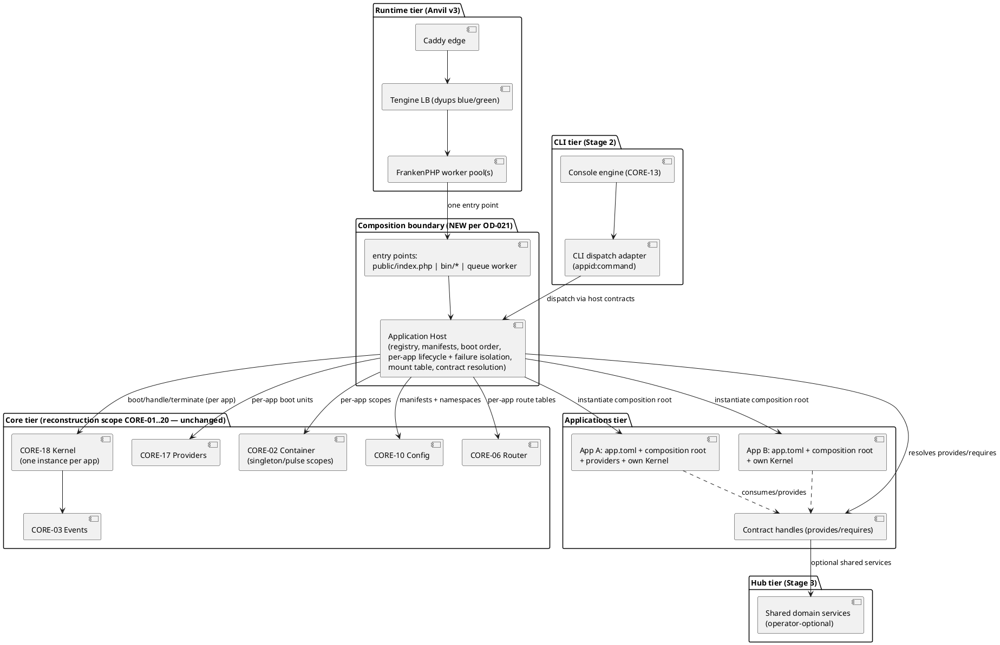
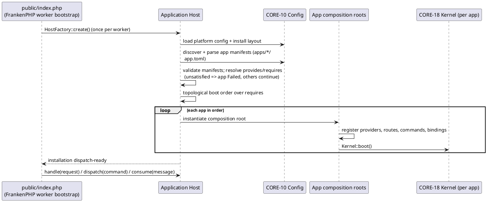
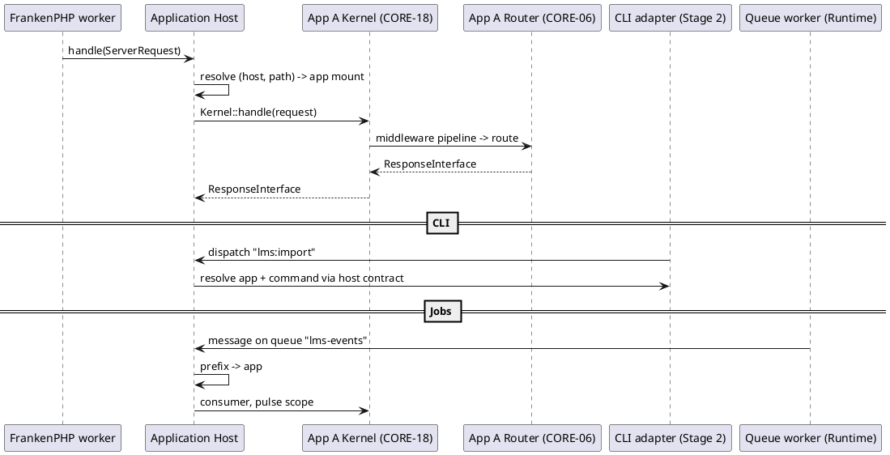

# SSTACK-ARCH-002 — Application Host Placement Assessment

**Assignment:** SSTACK-ARCH-002 — evidence-based assessment of *where* application hosting belongs within SStack's existing architecture, before any decision about *how* to implement it.
**Mode:** READ-ONLY — no implementation, no source/ADR/register/roadmap modification, no branches of implementation code, no merges. Published via pull request per the standing reporting instruction.
**Date:** 2026-11-27
**Author:** Z.ai

**Owner input framing this assessment (OWNER-COMMUNICATED via directive, not yet recorded in the repository):**

> Owner Decision OD-021 has been approved. SovereignStack will support multiple independently composed applications as a first-class platform capability. This is new architecture beyond DGLab reconstruction.

The directive further instructs: *"Do not assume the answer is Core simply because the previous assessment recommended it."* That instruction is honoured — the prior assessment's lean (PR #6, §3.3: Core-tier placement) was re-derived from evidence and is **not** followed where the evidence contradicts it. The disagreement is documented openly in §5.10.

**Companion artifacts:**

| Artifact | Relationship |
|---|---|
| PR #6 `SSTACK-APP-HOSTING-ARCHITECTURE-ASSESSMENT.md` | The prior independent platform assessment. This report inherits its REPOSITORY/SOURCE/DOCUMENT-VERIFIED ground truth (§2) and its platform model where placement-neutral; it revises only the *placement* lean. |
| PR #4 (CCR-001), PR #5 (CCR-002) | Verified repo-state and CORE-10 defect evidence reused here. |

---

## How to read this report

Every claim carries an evidence classification:

| Tag | Meaning |
|---|---|
| **REPOSITORY-VERIFIED** | Confirmed directly from the SStack repository / git state this session |
| **SOURCE-VERIFIED** | Confirmed directly from DGLab source code at baseline `543329ed84a2148308e0cc455ac7e2fe27cf35f4` |
| **DOCUMENT-VERIFIED** | Confirmed from an authoritative DGLab architecture document (ADR, blueprint, roadmap) |
| **TEST-VERIFIED** | Confirmed by executing code in a fresh checkout (per CCR-001) |
| **OWNER-COMMUNICATED** | Stated in this assessment's directive; not yet verifiable in the repository |
| **INFERRED** | Reasonable interpretation of verified evidence; not explicitly established |
| **PROPOSED** | Recommendation of this assessment awaiting owner decision |
| **UNVERIFIED** | Could not be confirmed |

Verified facts, agent inferences, and recommendations are kept distinct throughout: facts appear in §2 and inside option analyses with tags; inferences are labelled INFERRED; all recommendations are PROPOSED and collected in §5, §10, §11.

---

# 1. Executive Summary

## 1.1 The question and the answer

OD-021 ratifies multi-application hosting as **new architecture beyond DGLab reconstruction**. This assessment answers the single question it poses: *which part of SStack should own application hosting?*

**Recommendation (PROPOSED): Option E — a dedicated Application Host capability located at the installation composition boundary** — a new top-level platform component that sits **above Core and below applications, outside Hub and CLI, inside no existing tier**. It is the direct generalisation of the single verified composition pattern DGLab already has: `public/index.php` → `app/ApplicationFactory` (one application) becomes `public/index.php` → **Application Host** (N applications).

It is *not* Option A (inside Core). It is *not* Option B (inside Hub). It is a specific, evidence-grounded refinement of Option C (dedicated capability outside existing tiers): the capability is placed at the **composition boundary DGLab's own documents recognise**, rather than in a newly invented middle tier.

## 1.2 The three decisive reasons (all evidence-based)

1. **The verified composition precedent forbids it in Core.** DGLab's own composition root states, verbatim, that it *"belongs at the application/infrastructure composition boundary, NOT inside Core"* (SOURCE-VERIFIED, `app/ApplicationFactory.php` docblock, quoting SPEC §3). The Application Host *is* the composition mechanism, generalised from one application to N. Everything DGLab says about why `ApplicationFactory` must not live in Core applies with equal force to the host.
2. **A Core-tier host cannot satisfy OD-007's completion criteria.** Per-component completion requires *"verified source and blueprint requirements (DGLab source inspected, blueprint read)"* (DOCUMENT-VERIFIED, implementation-sequence.md, OD-007 criteria #1). The Application Host has **no DGLab blueprint and no DGLab source** — DGLab hosts exactly one application (SOURCE-VERIFIED, full `app/` inspection, PR #6 §1.1). A Core component with no reconstruction reference cannot pass the gate that governs Core-tier work. Placing it outside Core gives OD-021's new architecture its own home without contaminating the reconstruction discipline.
3. **The Kernel contract must stay frozen.** CORE-18 is *"the only class in the system that knows about every other Core-tier component by name"* and is *"deliberately tiny"* (DOCUMENT-VERIFIED, CORE-18 blueprint). Placement at the composition boundary lets each application keep **its own Kernel instance — the frozen three-method contract unchanged** — with the host as coordinator. Placing hosting inside Core either extends the Kernel contract (breaking a frozen, ratified contract) or creates a second everything-knowing choke point beside it.

## 1.3 What the recommendation preserves

- The binding sequence **Core → CLI → independent tiers → Loom → integration** is unchanged (OD-009); the host needs no roadmap amendment to be sequenced (two owner options, §8).
- **No existing component's responsibilities change.** The host *orchestrates* Core primitives (CORE-18 Kernel, CORE-17 Providers, CORE-02 Container, CORE-10 Config, CORE-06 Router, CORE-03 Events, CORE-08/09 error/log) — it replaces none of them, adds no HTTP/CLI/domain knowledge to them, and is invisible to them (Core never imports the host).
- **Core↛CLI, CLI↛Hub, CLI-not-required-to-boot-Core** all remain intact: the HTTP entry point boots the host → Core with no CLI involvement; the CLI tier is a *client* of host contracts, never their owner.
- Every architecture-independent property the owner values: the host is a small, independently testable component; apps remain manifest-declared composition units (PR #6 §3.1 model); isolation guarantees stay honestly stated per ADR-017 (no security-isolation claims — PR #6 §5.2 ladder applies unchanged).

## 1.4 One-line placement rule

> **Hosting is composition, and composition belongs to the installation — not to Core, not to Hub, not to CLI.** The Application Host is the installation's composition root, generalised from one application to many.

---

# 2. Verified Current Architecture

## 2.1 SStack repository state (REPOSITORY-VERIFIED, inspected 2026-11-27)

| Item | State |
|---|---|
| `main` | `bce2f43` — initial commit only (README). **No framework code is merged.** |
| PR #3 `feature/core-10-config` (`c377cb4`) | CORE-10 implementation — open, under owner review; 34 PHPStan level-max errors and 3 TOML parser defects documented (TEST-VERIFIED, CCR-001). The **only** SStack implementation in existence. |
| PR #2 (`d042db1`) | Binding CORE-10 spec v3 + K-S0b analysis suite + `owner-decisions-2026-11.md` — open. |
| PR #4, #5, #6 | CCR-001 context restoration; CCR-002 TOML 1.1 research; the prior independent application-hosting assessment (this report's companion). |
| PR #1 | Closed, not merged (early CLI+Core attempt). |

**Consequence (REPOSITORY-VERIFIED):** SStack today contains one partially-reviewed Core component (CORE-10) and no Kernel, Container, Service Providers, Router, CLI, Hub, Bridge, or runtime. Everything else exists as DGLab blueprints/source and approved decisions — which is precisely what the directive's §5 investigation must separate.

**Governance gaps carried into this assessment (REPOSITORY-VERIFIED):**

- **OD-021 is not recorded in the repository.** `owner-decisions-2026-11.md` remains 101 lines, ending at OD-009 plus the CORE-10 D/B-series. The decision exists only in the owner's directive (OWNER-COMMUNICATED). It must be recorded before implementation-relevant work keys off it (§10, P7).
- **ADR-S01 and ADR-S02 still do not exist as files**, while seven+ documents call them "frozen and binding" (carried finding from CCR-001; reconfirmed — no such file on any branch).
- OD-010…OD-020 are likewise absent from the register; their content, if they exist owner-side, is UNVERIFIED here.

## 2.2 Component investigation — implemented vs documented (assignment §5)

The directive requires inspecting responsibilities *and readiness* of the named components, distinguishing implemented from planned. The table below is that inventory, compiled from the K-S0b suite (DOCUMENT-VERIFIED) with direct re-verification of DGLab source listings (SOURCE-VERIFIED).

| Component | DGLab blueprint status | DGLab source at baseline (implementation reality) | SStack status | Hosting-relevant readiness |
|---|---|---|---|---|
| **Kernel** (CORE-18) | Full blueprint, ratified (re-authored K-S0b-era spec; Build Status text in the blueprint says "not started" while source exists — a documented blueprint/source drift the K-S0b suite reconciles in favour of source) | **Implemented** — 15 files: `Kernel`, `KernelInterface`, `KernelState` (`Unbooted→Booting→Booted→Handling→Terminating→Terminated`), `HttpBootstrapper`, `RequestContext`, lifecycle events, `PanicException`, worker-contamination tests. **Single-application kernel**: one container, one router, one config, one logger, one error handler; `boot()/handle()/terminate()`; worker-scoped; consumes a *stub* provider registry | Not reconstructed (Wave 2 per sequence) | **Orchestration target.** One Kernel per application is exactly the DGLab pattern; contract requires zero multi-app changes (§5.9) |
| **Container** (CORE-02) | Full blueprint | **Implemented** — 8 files; PSR-11 `get/has` + native `bind/singleton/instance/make/compile`; `singleton()` = worker-scoped; `pulse()` = per-Fiber via `WeakMap` (SOURCE-VERIFIED, `Container.php`); compile freeze; PSR-11 conformance tests | Not reconstructed (Wave 1, order 2) | Per-app service isolation within a worker via per-app container instances / scope keying |
| **Service Providers** (CORE-17) | Full blueprint (OD-004: native implementation required) | **STUB ONLY** — `Core/Kernel/Stub/ProviderRegistryInterface` + `EmptyProviderRegistry` ("CORE-17 is not yet implemented… temporary placeholder", SOURCE-VERIFIED) | Not reconstructed (post-Kernel deferred group) | **Host prerequisite.** Providers are the per-app boot units: priority-sorted `register()`/`boot()`, then container `compile()` freeze; any `boot()` exception fatal; discovery restricted to explicitly registered directories, no global classmap scans (DOCUMENT-VERIFIED blueprint) |
| **HTTP infrastructure + Router** (CORE-04/05/06) | Full blueprints | **Implemented** — HttpMessage 14 files, Middleware 8, Router 13 (attribute-based) | Not reconstructed (Wave 1) | Per-app route tables and middleware pipelines exist per-app already in the DGLab shape; host adds only the mount table (§5.6) |
| **Request lifecycle & worker scopes** | ADR-017 ratified (Fiber cooperative runtime; FrankenPHP worker mode primary; PHP-FPM recorded as incompatible with the cooperative model) | **Implemented at app boundary** — `app/Runtime/RequestLoop` (boot once per worker; `frankenphp_handle_request` loop; worker recycling `max_requests=500` per SPEC §35 docblock; FPM single-request fallback retained in source) + Kernel states + Container `pulse()` | Not reconstructed | The dispatch envelope the host reuses per request; worker recycling is Anvil substrate policy |
| **Configuration** (CORE-10) | Blueprint + binding reconstruction spec v3 (894 lines) | **Implemented** — 10 files | **PR #3 open, under review, documented defects** (TEST-VERIFIED CCR-001: 34 PHPStan level-max + bleedingEdge errors; 3 TOML parser bugs) | Manifest format + per-app config namespaces. Remediation unaffected by this assessment |
| **Cache** (CORE-15) | Blueprint only | **MISSING** — 0 files (DOCUMENT-VERIFIED, K-S0b inventory; OD-003 native cache) | Not started | **Not a host prerequisite.** Key-prefix and per-app store policy can precede the cache component; initial host work needs no cache API |
| **Events** (CORE-03) | Full blueprint | **Implemented** — 7 files (PSR-14) | Not reconstructed (Wave 1) | Lifecycle signals per app (Boot/RequestReceived/ResponseReady/Terminate events exist in Kernel) |
| **CLI Console** (CORE-13) | Full blueprint (Application, Command, Input/Output, `#[AsCommand]`, CommandRegistry) | **MISSING** — only 2 procedural scripts (`CLI/migrate.php`, `CLI/seed.php`); no console engine exists | Not reconstructed (CLI tier = Stage 2, after Core per OD-009) | App-command dispatch (`appid:command`) is **CLI-tier adapter** work consuming host contracts — not host work; the blueprint's own naming example (`forge:make:hub`) already uses `tool:action` namespacing (DOCUMENT-VERIFIED) |
| **Hub** (HUB-01..32) | 32 blueprints | Only 2 of 32 implemented: `Hub/Config` (feature flags) and `Hub/Identity` (SOURCE-VERIFIED tree listing) | Not reconstructed (Stage 3) | Consumed by apps via Core-bound contracts; operator may share Hub services across apps. **Never a host location** (§4.3) |
| **Bridge** (BRIDGE-01) | Blueprint | **Implemented** — `Bridge/Vanguard`: `Vanguard`, `ContractRegistry`, `WafInspector`, `DefaultDtoTransformer`; wired as outermost middleware at the app boundary (SOURCE-VERIFIED, ApplicationFactory imports) | Not reconstructed (Stage 3) | The contract-registry precedent for inter-app `provides`/`requires` resolution (PR #6 §6 model, placement-neutral) |
| **Runtime / Anvil** | ADR-021 substrate tier | **Present** — Caddy→Tengine(dyups blue/green, health-gated)→FrankenPHP; per-tenant on-demand TLS (SOURCE-VERIFIED per PR #6 §2.6) | Not reconstructed | Config-driven substrate only: the host *never imports Anvil code*; per-app worker pools and deploys are expressed as installation layout consumed by Anvil tooling |
| **app/ composition root** | SPEC-001 §44 + SPEC §3 discipline | **Implemented** — `app/ApplicationFactory.php` (432 lines, once-per-worker, "MUST NOT become a service locator", "composes existing Core/Bridge components… does NOT introduce competing abstractions") + `Application` state machine + `RequestLoop` | n/a (the pattern SStack generalises) | **The pattern the host generalises** (§5.1) |

**Verified summary:** of the components hosting must orchestrate, DGLab has implementations for Config, Container, Kernel, Router, HTTP, Middleware, Events, Error, Logging — a **stub** for Service Providers — and **nothing** for Cache and the CLI Console. SStack has implemented none of them (CORE-10 alone, under review). Therefore *every* hosting capability discussed here is PROPOSED future architecture; the placement decision determines only **where it will live and what it may touch**, not anything that exists today.

## 2.3 The verified entry-point chain (the pattern placement must generalise)

```
public/index.php            (thin entry; worker bootstrap under FrankenPHP)
  → ApplicationFactory::create()   (once per worker; composition boundary per SPEC §3)
      → composes Container, EventDispatcher, Logger, ErrorHandler,
        Vanguard (Bridge), Router, MiddlewarePipeline
      → builds Kernel (custom bootstrapper wires routes + Vanguard)
  → Application::run() → RequestLoop
      → Kernel::boot() once; Kernel::handle() per request; Kernel::terminate() at shutdown
```

All steps SOURCE-VERIFIED from `public/index.php`, `app/ApplicationFactory.php`, `app/Runtime/RequestLoop.php` docblocks and code. The CORE-18 blueprint confirms the same envelope for CLI: `bin/loom` / `bin/forge` call `Kernel::boot()` → dispatch command → `Kernel::terminate()` (DOCUMENT-VERIFIED, Downward section).

**This chain is the placement datum.** DGLab already answers "who composes the platform and dispatches into the application?" — a composition root at the application/infrastructure boundary, explicitly **not inside Core**. OD-021 changes only the *cardinality*: N applications instead of 1.

## 2.4 Tier taxonomy and boundary rules (DOCUMENT-VERIFIED)

Five ratified tiers (ADR-021, two-DAG governance): **Runtime** (Anvil v3, timers, queue worker, Chronos) / **Core** (CORE-01..20, "pure libraries; contract-coupled, not class-coupled — verified: only CORE-18 Kernel imports sibling Core namespaces") / **Hub** (HUB-01..32 domain services) / **Applications** (ESPOKE-01..19 + ISPOKE-01..27 + BRIDGE-01, per-application DAGs, each ESPOKE owns its manifest) / **Deploy+Tooling** (DEPLOY-00..04 + CORE-13 + CORE-20).

Boundary rules binding this assessment (owner-decisions register + roadmap + implementation-sequence, DOCUMENT-VERIFIED):

- Core must never depend on CLI; Hub must never depend on CLI.
- CLI must never depend on Hub; CLI is not required to boot Core.
- Reconstruction order (OD-009, binding): Core → CLI → independent tiers → Loom → integration.
- OD-006/OD-007: one tier / one component at a time; no stubs or placeholders; per-component completion requires verified DGLab source/blueprint requirements.
- Dependency policy: no third-party implementation libraries; PSR contracts allowed where required.
- ADR-016 (library/application boundary split; status **Proposed**, not Accepted): distinguishes versioned library packages (`packages/core`, `packages/hub`) from application code (`app/…`) — its layout language is consistent with the composition-boundary placement recommended here (noted in §9).

## 2.5 What DGLab does not have (and why that governs placement)

DGLab has **no application registry, no multi-app dispatch, no per-app lifecycle machinery, no manifest schema, no hosting contracts** (SOURCE-VERIFIED via full `app/`, `Core/`, orchestrator inspection; PR #6 §1.1). This is why OD-021 declares hosting *new architecture beyond reconstruction*. The placement question therefore cannot be answered by "which DGLab component did hosting?" — none did. It must be answered by *which placement best respects the verified composition discipline and the ratified rules* — which §4 does per the directive's eleven criteria.

---

# 3. Placement Criteria and Hard Constraints

**Evaluation dimensions (assignment §3, applied to every option):** (1) dependency direction; (2) responsibility ownership; (3) bootstrapping and lifecycle; (4) application registration and discovery; (5) HTTP request dispatch; (6) CLI integration; (7) service sharing; (8) application isolation; (9) long-running worker support; (10) testing and maintainability; (11) future independent deployment.

**Hard constraints (assignment §4 + verified register):**

| # | Constraint | Source |
|---|---|---|
| H1 | Core must not depend on CLI | OD/ADR-S01-by-reference (DOCUMENT-VERIFIED) |
| H2 | CLI and Hub remain independent; CLI not required to boot Core | same |
| H3 | Existing approved component responsibilities preserved unless an explicit conflict is presented | assignment §4 + OD-008 governance |
| H4 | No duplication of existing functionality | assignment §4 |
| H5 | No third-party implementation dependencies | binding dependency policy |
| H6 | Binding sequence Core → CLI → independent tiers → Loom → integration; OD-021 does not automatically change it | assignment §4 + OD-009 |
| H7 | Composition belongs at the application/infrastructure boundary, not inside Core | SPEC §3 via ApplicationFactory docblock (SOURCE-VERIFIED) |
| H8 | Core-tier component completion requires verified DGLab source/blueprint requirements | OD-007 criteria (DOCUMENT-VERIFIED) |

H7 and H8 are not new constraints invented here — they are existing verified rules with direct bearing on placement, surfaced by the evidence above.

---

# 4. Alternative Placement Comparison (Deliverable 2)

## 4.1 Comparison matrix

| Criterion (§3 list) | A: in Core | B: in Hub | C: new platform tier | D: distributed | **E: composition-boundary host** |
|---|---|---|---|---|---|
| Dependency direction | ~ legal but creates a 2nd choke point | ✗ violates CLI↛Hub, makes Hub boot-critical | ✓ clean | ✗ smears multi-app awareness everywhere | ✓ clean, one direction (host→Core) |
| Responsibility ownership | ✗ Core = pure libraries + fixed CORE-01..20 scope | ✗ hosting is not a domain service | ✓ dedicated | ✗ no owner for cross-cutting orchestration | ✓ dedicated, mirrors verified precedent |
| Bootstrapping & lifecycle | ~ possible | ✗ circular (Hub is booted *by* the Kernel) | ✓ | ✗ no deterministic boot order | ✓ host boots N kernels in requires-order |
| Registration & discovery | ~ via Config schema | ~ | ✓ | ✗ scattered across components | ✓ manifest + registry at boundary |
| HTTP request dispatch | ~ mount table in Core = platform policy in library tier | ✗ entry point would import Hub | ✓ | ✗ Router contract changes | ✓ host→app kernel; Router untouched |
| CLI integration | ✓ CLI imports a Core ns (legal, semantic smell) | ✗ | ✓ | ~ | ✓ CLI is a client of host contracts |
| Service sharing | ✓ | ✓ | ✓ | ~ | ✓ explicit: Core shared by code; Hub shared by operator choice |
| Application isolation | ~ mechanics equal; placement adds nothing | ~ | ✓ | ✗ weakest coordination point | ✓ same mechanics, honest ADR-017 ladder |
| Long-running workers | ~ | ✗ queue worker would depend on Hub | ✓ | ~ | ✓ per-app kernels; Anvil pool policy |
| Testing & maintainability | ✗ OD-007 criteria unsatisfiable (no DGLab reference) | ~ | ✓ | ✗ no seam; N partial multi-app concerns | ✓ independently testable vs Core fakes |
| Future independent deployment | ~ conflates library with install policy | ✗ | ✓ | ✗ | ✓ the host *is* the per-installation composition unit |
| **Rule breaches (H1–H8)** | **H7, H8** (and Core-scope ratification change) | **H1/H2-class violations** | none (new-tier ceremony cost) | **H3/H4** (frozen contracts reopened) | **none** |

## 4.2 Option A — Application Host within Core

*Dependency direction:* a Core host importing sibling Core namespaces is technically the same exception the Kernel already holds, so it is *legal* (INFERRED). But it places a second orchestrator beside CORE-18, whose blueprint declares the Kernel "the **only** class in the system that knows about every other Core-tier component by name" (DOCUMENT-VERIFIED) — either the host becomes a second choke point, or the Kernel contract is extended, breaking a frozen contract.

*Responsibility ownership:* ADR-021 defines Core as "pure libraries"; the K-S0b inventory fixes Core's scope at CORE-01..20. A hosting component is installation policy (which apps, what boot order, what layout, what failure containment), not library code — the same distinction ADR-016 draws between versioned libraries and application code (DOCUMENT-VERIFIED).

*Bootstrapping/lifecycle, registration, dispatch, CLI, sharing, isolation, workers:* mechanically feasible in several shapes; none of the mechanics differ from Option E — placement is the only variable. The mechanics are therefore not the discriminator.

*Testing & maintainability — the decisive governance fact:* OD-007 criterion #1 for every Core component is "verified source and blueprint requirements (DGLab source inspected, blueprint read)". The host has **no DGLab source and no DGLab blueprint** (§2.5). A Core-tier host therefore cannot pass the completion gate that governs the tier it sits in, unless the owner first changes the rules for Core (a scope amendment to the ratified tier inventory and to OD-007's applicability). That is precisely the kind of silent redefinition the owner's governance is designed to prevent (OD-008; the directive's §4: existing responsibilities preserved unless an explicit conflict is presented).

*Precedent:* H7 — DGLab's own composition root says it belongs at the boundary, **not inside Core**. A Core host contradicts the strongest composition precedent in the verified corpus.

*Verdict: rejected as primary placement.* Salvage note: genuinely generic leaf mechanisms a host might later want (e.g., a TOML manifest schema util, a topological-order utility) *could* enter Core as libraries someday — via a future owner decision, after reconstruction of the ratified 20 — without hosting itself living there (INFERRED, PROPOSED for the owner's menu, not a near-term action).

## 4.3 Option B — Application Host within Hub

Rejected on verified tier rules (DOCUMENT-VERIFIED): Hub is a domain-services tier; it must never be required to boot, and CLI must never depend on Hub — but CLI dispatch of app commands would need the host, and every HTTP/queue entry point would depend on a Hub service. The boot story is circular: in the ratified model Hub services are themselves booted by the Kernel via providers (CORE-18 blueprint Downward), so a host *inside* Hub would be booted by the very layer it must orchestrate. Hosting is not a domain capability; placing it in Hub is a category error with rule violations attached.

## 4.4 Option C — dedicated platform runtime capability outside existing tiers (as a new middle tier)

Viable: a new "Platform" tier between Core and Applications would give the host a clean home with clean dependencies (host→Core; apps→host; CLI→host contracts). It fails two softer tests: it amends the ratified five-tier taxonomy (ADR-021 two-DAG governance) for the benefit of one initial component, and it interposes a tier where DGLab's own layout shows a *boundary*, not a tier: composition code (`app/` + `public/index.php`) sits outside every tier, at the application/infrastructure boundary (SOURCE-VERIFIED; ADR-016's language agrees). **Option E is this option, re-homed at that boundary** — same dependency arrows, no invented middle tier, exact precedent match. C is retained as the fallback framing should the owner prefer an explicit taxonomy change (P2 in §10).

## 4.5 Option D — application hosting distributed across existing components

Rejected. Distribution means each existing component grows a slice of multi-app awareness: Kernel (per-app getters or app-scoped kernels), Router (mount tables), Config (manifest schema), CORE-17 (per-app provider sets), Bridge (cross-app registry). Four ratified/frozen contracts reopen; the cross-cutting concerns — boot order over `requires`, per-app failure isolation, registration validation, contract resolution — still need a coordinator, so a fifth partial owner appears anyway; OD-007's one-component-at-a-time discipline would be spent *reopening* reconstructed components instead of adding one new one; and end-to-end multi-app behaviour loses its single testable seam. The sum of local changes exceeds the cost of one thin new component at the boundary (INFERRED from the verified contract surface of each component).

## 4.6 Option E — dedicated capability at the installation composition boundary

**Recommended (PROPOSED).** Full specification in §5. In one sentence: the Application Host is a new top-level platform component living at the composition boundary DGLab already recognises — above Core, below applications, beside (not inside) CLI and Hub — orchestrating N per-application composition roots and their per-app Kernels.

---

# 5. Recommended Application Host Architecture (Deliverable 3)

*Responsibility boundaries first, per the directive ("do not prematurely specify every class or interface"). Class-level design belongs to the future blueprint (ARCH-APP-01), not to this assessment.*

## 5.1 Recommendation statement

**Application Host ownership (PROPOSED):** a single dedicated component — provisional name *Application Host*, provisional home `host/` (namespace e.g. `SovereignStack\Host`) at the repository/installation root, i.e. the composition boundary. It owns:

1. **Manifest-driven registration and discovery** of applications (`apps/<id>/app.toml`, CORE-10 TOML; explicit directory list, no global scans — CORE-17's discipline, DOCUMENT-VERIFIED).
2. **Boot-order computation** over declared `requires` (topological sort; the same class of algorithm ADR-004 ratified for the orchestrator's tier ordering).
3. **Per-application boot orchestration**: instantiate each app's composition root (the SPEC-001 §44 pattern, one per app), run its providers (`register()`/`boot()`), compile its container scope, boot its Kernel.
4. **Per-application lifecycle and failure isolation**: app states `Registered→Validating→Resolving→Booting→Active/Failed/Reloading/Draining→Stopped`; one app's boot failure removes *that app's* dispatch entries; the installation continues.
5. **Dispatch multiplexing** across the three entry classes: HTTP (host→path mount table→app kernel), CLI (command namespace→app, via CLI-tier adapter), queue (queue-name prefix→app consumer) — with routing conflicts as **boot-time failures**, not request-time 500s.
6. **Inter-application contract resolution** at boot over `provides`/`requires` (Bridge `ContractRegistry` pattern generalised; consumers get contract handles, never provider class names).

**What it must NOT contain (anti-accretion, PROPOSED as a lint rule, cf. PR #6 §9.3):** HTTP semantics beyond the mount table, CLI parsing, domain logic, rendering, persistence, or any application-specific knowledge. Adapters stay in their tiers.

## 5.2 Component view



**Division of responsibility (PROPOSED):**

| Concern | Owner | Anchored in |
|---|---|---|
| Edge routing, TLS, pools, blue/green swaps | Anvil (Runtime) | verified substrate role (PR #6 §2.6) |
| Process/worker lifecycle | FrankenPHP + per-app Kernel | ADR-017; Kernel contract |
| Boot order, per-app failure isolation, manifest validation, contract resolution, mount table | **Application Host (composition boundary)** | this assessment |
| Per-app composition, business logic, internal structure | each application | SPEC-001 §44 pattern (SOURCE-VERIFIED) |
| HTTP dispatch into an app | app's Router via its Kernel; host only selects the app | CORE-06/18 unchanged |
| CLI dispatch into an app | CLI-tier adapter over host contracts | CORE-13 blueprint (Stage 2) |
| Inter-app calls | declared versioned contracts, resolved at boot | Bridge ContractRegistry pattern |
| Data ownership, sessions, cache keys, logs | each app (namespace/prefix/channel) | PR #6 §6.2 (placement-neutral) |

## 5.3 Bootstrapping sequence



**Sequence rules (PROPOSED):** platform config loads first (CORE-10 precedence D2); manifests are validated by the CORE-10 validator (D6, reuse not new machinery); contract failures and route/mount conflicts are boot failures (fail-fast, CORE-17's fatal-boot philosophy, DOCUMENT-VERIFIED); the host itself follows composition-root discipline — private readonly fields, no service locator (SPEC §44 verbatim rule, SOURCE-VERIFIED).

## 5.4 Application registration and discovery

Manifest-declared, directory-explicit, no auto-discovery scans: an application exists iff its manifest is in the installation's configured app directory. App identity (`id`) keys the config namespace (`apps.<id>.*`), command namespace (`id:command`), queue prefix, log channel, cache key prefix, and route mounts. Registration-time validation covers id uniqueness, route/mount conflicts, queue-prefix conflicts, and contract satisfaction. Operators list apps through the CLI adapter (`sstack app:list`, Stage 2 DX). All PROPOSED; the app model itself is inherited from PR #6 §3.1 unchanged.

## 5.5 Application lifecycle and failure handling

```plantuml
@startuml
state Registered -r-> Validating
Validating -r-> Resolving : manifest + contracts OK
Validating -r-> Failed : invalid manifest / contract
note right of Failed : boot of OTHER apps continues
Resolving -r-> Booting : dependency-order turn
Booting -r-> Active : providers register+boot,\nper-app container compiled
Booting -r-> Failed : provider boot exception\n(fatal within the app, isolated by host)
Active -r-> Reloading : per-app hot reload
Reloading -r-> Active
Active -r-> Draining : blue/green swap (Anvil dyups)
Draining -r-> Stopped : in-flight requests finished
Failed -r-> Booting : operator retry
Stopped -r-> Booting : re-enable
@enduml
```

State semantics inherited from PR #6 §4.2 (PROPOSED on ADR-017's documented ACTIVE/FAILED/RELOADING vocabulary), with placement-relevant semantics fixed here:

- **Per-app failure isolation:** a failed app's mounts/commands/consumers are removed from dispatch; the host answers 503 on that app's mounts; other apps and the platform continue. Within one app's own wiring, provider boot exceptions remain fatal (CORE-17 discipline) — a half-wired app must not serve.
- **Reload/drain:** per-app hot reload and blue/green drains delegate to Anvil dyups health-gating at the substrate (verified capability); the host's part is state bookkeeping and dispatch-entry updates.
- **Recovery:** operator retry re-enters Booting for the failed app only.

## 5.6 Request, command, and job dispatch responsibilities



**Responsibility split (PROPOSED):** the host owns *selection* (which app), never *execution* (the app's Kernel/Router/Console own that). Deterministic rules from PR #6 §7 are inherited: hosts assigned exclusively; path mounts unique per host; host→path evaluation order; CLI commands namespaced by app id; queue prefixes by app id; all conflicts are boot failures. The HTTP edge (Anvil vhosts) aligns 1:1 with host-level mounts (verified substrate capability).

## 5.7 Service-sharing boundaries

Inherited from PR #6 §6 (placement-neutral, PROPOSED): Core primitives are shared by *code* (one implementation, per-app scopes); Hub services are shared by *operator choice* (apps consume via Core-bound contracts; credentials per app from env per CORE-10 secret origins); app-owned resources (config namespace, routes, schema, cache keys, sessions, logs) are fenced by namespace/prefix/channel; inter-app access only through resolved versioned contract handles. Nothing about placement changes these boundaries; what changes is *who enforces them at boot* — the host (registration-time validation), instead of nothing.

## 5.8 Interaction with existing tiers

| Tier | Interaction (PROPOSED) | Independence preserved? |
|---|---|---|
| Core | host imports Core contracts; Core never imports host | ✓ Core unchanged, reconstruction stream untouched |
| CLI | CLI-tier adapter consumes host contracts to reach apps; host never imports CLI; host boots fine with no CLI present | ✓ H2 intact; CLI remains a client |
| Hub | No imports either way; apps consume Hub services via Core-bound contracts when operator-shared | ✓ |
| Runtime/Anvil | No code imports; installation layout is configuration consumed by Anvil tooling (pools, vhosts, dyups) | ✓ substrate stays substrate |
| Applications | apps depend on Core + host-published contracts (manifest schema, composition-root interface, contract handles); never host internals; never each other's namespaces (boundary-lint error, PR #6 Q8 retained) | ✓ |
| Loom (Stage 4) / Forge (Stage 4+) | out of scope here; Loom-era multi-repo packaging and Forge scaffolding are future decisions (P9/P10) | ✓ |

## 5.9 Why per-app Kernel instances — the contract-preservation argument

Under Option E the host composes **one Kernel per application** — each app gets exactly the DGLab shape: own Kernel, own container, own providers, own router, own middleware pipeline, own config namespace. The CORE-18 contract (`boot/handle/terminate`, single-container getters, state machine, "deliberately tiny") is **frozen and untouched**; CORE-06 Router, CORE-02 Container, CORE-17 Providers contracts likewise need zero multi-app extensions. This is the placement's central architectural payoff: multi-app behaviour emerges from *composition*, not from contract surgery on ratified components (H3/H4 satisfied by construction). A single shared Kernel would conversely require multi-app getters, scoped routing, and per-app failure states *inside* CORE-18 — reopening a frozen contract (rejected with Option D's logic).

## 5.10 Honest comparison with the prior assessment (ARCH-001 / PR #6)

The prior assessment recommended a "thin Application Host capability in the Core tier" (PR #6 §3.3, recommendation R2) while explicitly leaving placement sequencing to the owner (its C-A/Q2). This assessment disagrees with the *Core-tier* lean, on evidence its own §2 established but did not apply to placement:

| Prior position | This assessment | Basis |
|---|---|---|
| Host = thin, generic, orchestrates approved primitives, replaces none | **Retained entirely** | placement-neutral design (H4) |
| Placement lean: Core tier | **Revised: composition boundary** | SPEC §3 (H7) + OD-007 criteria unsatisfiability (H8) + Kernel capstone uniqueness — §1.2 of this report |
| Q2 asked "where does the host land" (Stage 1 vs new stage) | Answered: at the composition boundary, sequenced R-1/R-2 (§8) | the directive's mandate |
| Platform model: manifest apps, isolation honesty ladder, contracts, progressive DX | **Retained** | unaffected by placement |

The disagreement is *where*, not *what*: the prior report's §3.3 itself rejected CLI, Hub, a new Platform tier, and infra-only placements for reasons this assessment independently confirms; the remaining candidate set was Core vs the composition boundary, and the verified rules H7/H8 settle it for the boundary.

---

# 6. Component Responsibility Matrix (Deliverable 4)

| Concern | Application Host (boundary) | Kernel (per app) | Container (per app) | Providers (per app) | Router (per app) | Config | CLI tier | Hub tier | Anvil | App composition root |
|---|---|---|---|---|---|---|---|---|---|---|
| Manifest load/validate | **owner** | — | — | — | — | schema via CORE-10 | — | — | — | authored |
| App registry + identity | **owner** | — | — | — | — | namespace `apps.<id>` | list UI | — | — | — |
| Boot order (requires graph) | **owner** | — | — | priority within app | — | — | — | — | — | — |
| Per-app boot | orchestrates | boots | compiled per app | register()/boot() units | frozen post-boot | loaded first | — | — | — | constructs services |
| Request dispatch (which app) | **owner** (mount table) | — | — | — | — | — | — | — | vhost alignment | — |
| Request execution | — | **owner** | resolves | — | **owner** (match) | — | — | — | — | handlers |
| CLI command dispatch | resolves app+command | — | — | — | — | — | **owner** (parse/execute) | — | — | commands |
| Queue consumption | prefix→app | — | pulse scope | — | — | — | — | — | worker substrate | consumers |
| Inter-app contracts | **resolves at boot** | — | — | — | — | — | — | — | — | declared in manifest |
| Per-app failure isolation | **owner** | fatal within app | — | fatal boot | — | — | exit codes | — | health-gated pools | — |
| App lifecycle states | **tracks** | KernelState per app | — | — | — | — | surfaced (`app:list`) | — | health checks | Application states |
| Config ownership | install layout | app view | — | — | — | **owner** (CORE-10) | — | — | — | app files |
| Logging channels | platform channel | app channel | — | — | — | — | — | — | — | app channel |
| Secrets | env origins only | — | — | — | — | **owner** (policy) | — | — | — | env reads |
| Sessions/cache/storage | per-app prefixes enforced at registration | — | — | — | — | — | — | — | per-pool options | per-app stores |
| Worker recycling | — | — | — | — | — | — | — | — | **owner** (pools, dyups) | — |
| Static/global state discipline | lint rule at boundary | — | scopes over statics | — | — | — | — | — | — | composition-root only |

("—" = no responsibility added by this assessment; existing verified responsibilities unchanged.)

# 7. Dependency Rules (Deliverable 5)

**Allowed (PROPOSED):**

1. Application Host → Core contracts (`SovereignStack\Core\*`) and PSR interfaces only.
2. Entry points (`public/index.php`, `bin/*`, queue worker bootstrap) → Application Host.
3. Applications → Core; applications → Host-published contracts (manifest schema, composition-root interface, contract handles); applications → other applications **only** via resolved contract handles.
4. CLI tier → Core; CLI tier → Host contracts (for app-dispatching commands; optional — a CLI-only install without hosted apps needs neither).
5. Hub → Core only (unchanged).
6. Anvil tooling ← installation layout as configuration (no code dependency on the host).

**Prohibited (PROPOSED):**

1. Core → Host (never — Core must remain ignorant of hosting's existence).
2. Host → CLI; Host → Hub; Host → any application implementation namespace (only the app-facing contract interfaces); Host → Anvil code; Host → any third-party implementation (binding policy).
3. Applications → Host internals; applications → another application's namespace (boundary-lint error; PR #6 Q8 retained).
4. Core → CLI; CLI → Hub; Hub → CLI/Host (all pre-existing rules, restated, unchanged).
5. Any new dependency that would make Hub or CLI boot-critical for HTTP/queue entry paths.

**Direction summary:** exactly one new dependency direction enters the system — Host→Core — plus entry-point→Host. Nothing above Core changes; Core's own graph is untouched.

# 8. Roadmap Implications (Deliverable 7)

**Verified prerequisite chain (DOCUMENT-VERIFIED, implementation-sequence.md):** the host requires at minimum CORE-10 (manifests, namespaces), CORE-02 (per-app scopes), CORE-04/05/06 (HTTP dispatch types), CORE-08/09 (error/log channels), **CORE-18 (per-app kernels, Wave 2)**, and **CORE-17 (per-app boot units — currently in the post-Kernel deferred group, OD-004 native)**. Therefore the **earliest possible start for host work is after CORE-17 lands** — i.e., late Stage 1 at the soonest. CORE-15 (cache) is *not* a prerequisite (§2.2).

**The binding sequence is not changed by this recommendation.** Two sequencing options for the owner:

| Option | Content | Governance cost |
|---|---|---|
| **R-1 (PROPOSED alternative)** | Dedicated platform work immediately after Stage 1 completes (host before CLI) | Changes the practical order of tier work (CLI moves behind platform work) — **explicit owner decision required** per assignment §4; the five-stage order is amended |
| **R-2 (PROPOSED, lean)** | Host as the **lead component of Stage 3** (independent tiers), after CLI reconstruction | **No change to the approved sequence** — an addition, not an amendment; host blueprint authored any time after P1 approval |

**Lean: R-2.** It keeps the ratified order intact and lands hosting immediately when independent tiers open. R-1 is coherent if the owner wants hosting demonstrable before CLI reconstruction completes — its cost is a sequencing decision the owner must make explicitly, never silently (OD-008 discipline).

**Unchanged in every scenario (REPOSITORY/DOCUMENT-VERIFIED):** Stage 1 wave order; CORE-10 remediation (CCR-001 findings) as the current priority; CLI-before-Loom; OD-006/007 per-component discipline applying to the host the moment it becomes an authorised component (one component, full implementation, no stubs — the host will be the first *new-architecture* component to pass the same bar against its own approved blueprint instead of a DGLab blueprint).

# 9. Conflicts with Existing Approved Decisions (Deliverable 8)

| # | Item | Class | Resolution required |
|---|---|---|---|
| 1 | **No rule violation under Option E.** H1–H8 all satisfied (§4.1 matrix); no existing component's responsibilities change; no duplication (host orchestrates, never reimplements) | verified conclusion | none — but the owner must ratify the placement (P1), which *is* new architecture per OD-021 |
| 2 | **Prior assessment lean (PR #6 §3.3: Core tier)** | documented disagreement | owner resolves via P1; both positions on record (§5.10) |
| 3 | **OD-021 not recorded in the repository** (REPOSITORY-VERIFIED absence) | governance gap | record it (P7); also reconcile OD-010…OD-020 numbering if those decisions exist owner-side |
| 4 | **ADR-021's five-tier taxonomy has no named home for the composition boundary** | taxonomy gap, not violation (ADR-021 governs reconstruction tiers; OD-021 is beyond reconstruction) | a naming/amendment note when the host is ratified (P2) |
| 5 | **ADR-S01 / ADR-S02 remain non-existent files** while being called frozen-and-binding (carried) | governance gap | authorise them as files (P8, carried from PR #6) |
| 6 | **ADR-016 status "Proposed"** (library/app boundary split) | observation | its layout language *supports* Option E; no action needed for placement, but ratification would firm the boundary the host sits on |
| 7 | If the owner were to choose Option A instead: **H7, H8, and ratified Core scope would all require explicit amendment** | conditional | only relevant if the owner overrides this recommendation |

# 10. Open Questions Requiring Owner Approval (Deliverable 9)

| # | Question | Options | Lean |
|---|---|---|---|
| P1 | Ratify **Option E** — Application Host at the installation composition boundary, above Core, outside all existing tiers? | E / A / C-framing | E (this report) |
| P2 | Name + governance artifact for the host: component name (`Application Host`), home (`host/`, ns `SovereignStack\Host`), and its ADR/blueprint (recommend authoring **ARCH-APP-01** per SDLC-AGRD standards, as PR #6 §14 also proposed) | host/ vs platform/; ADR vs blueprint | `host/` + ARCH-APP-01 blueprint + an ADR-021 naming amendment note |
| P3 | Sequencing: R-1 (platform stage after Stage 1; resequences CLI) vs R-2 (Stage 3 lead, after CLI) | R-1 / R-2 | R-2 |
| P4 | Entry-path policy: every installation routes through the host (N=1 included) vs host optional | always / optional | always-through-host for installs; bare DGLab-style composition remains valid for library/test harnesses |
| P5 | Per-app Kernel model (one Kernel instance per app, CORE-18 contract untouched) | per-app / shared | per-app (§5.9) |
| P6 | Host-surface cap as a lint/architecture rule (no HTTP/CLI/domain knowledge in the host) | error / warn | error (mirrors DGLab boundary-lint precedent) |
| P7 | Record OD-021 in the owner-decisions register (and any OD-010…OD-020 that exist) | now / at next register update | now |
| P8 | Authorise ADR-S01/S02 to exist as files | yes / continue by reference | yes (carried) |
| P9 | First host blueprint scope: HTTP + lifecycle + registry only, or include CLI/queue adapters | HTTP-first / full | HTTP-first (CLI adapter lands with Stage 2; queue adapter with the Runtime tier work) |
| P10 | Loom-era packaging: whether the host becomes its own polyrepo package in the Stage 4 release matrix | defer / decide now | defer to Stage 4 planning |

# 11. Recommended Next Architectural Step (Deliverable 10)

1. **Owner:** record OD-021 in the register (P7) and resolve P1–P4 (placement, name/home, sequencing, entry policy). Nothing else blocks.
2. **Then (documentation only):** author `ARCH-APP-01` — the Application Host blueprint (placement per P1, contracts, manifest schema, lifecycle, dispatch spine, isolation statements per the ADR-017 honesty ladder, thin-surface rule) — to SDLC-AGRD/authoring-guide standards. This is the OD-007-grade requirement basis the host will be held to (the first component whose "verified blueprint requirements" are a *SStack* blueprint, not a DGLab one).
3. **Unchanged current work:** CORE-10 remediation per CCR-001; Stage 1 waves per the approved sequence.
4. **No implementation of the host is authorised by this report.** Implementation begins only after P1–P3 and ARCH-APP-01 approval, sequenced per P3.
5. Carry P8 (ADR-S01/S02 files) as standing hygiene.

---

# Appendix A — Evidence Register

| Claim | Source | Class |
|---|---|---|
| SStack repo state: main `bce2f43` initial; PRs #2–#6 open; PR #3 sole implementation | git + GitHub API, 2026-11-27 | REPOSITORY-VERIFIED |
| PR #3 defects (34 PHPStan level-max; 3 TOML bugs) | CCR-001 + fresh-checkout verification | TEST-VERIFIED |
| Owner-decisions register = 101 lines, ends OD-009 + D/B-series; OD-021 absent | `docs/architecture/owner-decisions-2026-11.md` @ `d042db1` | REPOSITORY-VERIFIED |
| ADR-S01/S02 files non-existent | CCR-001 + reconfirmed branch enumeration | REPOSITORY-VERIFIED |
| Entry chain: index.php → ApplicationFactory (once/worker) → Application → RequestLoop → Kernel::handle | `public/index.php`, `app/ApplicationFactory.php` (432 lines), `app/Runtime/RequestLoop.php`, `app/Application.php` | SOURCE-VERIFIED |
| "ApplicationFactory belongs at the application/infrastructure composition boundary, NOT inside Core"; "MUST NOT become a service locator"; composes, does not introduce competing abstractions | ApplicationFactory docblock quoting SPEC §3, §44, §15, §58 | SOURCE-VERIFIED |
| Kernel: single-app; boot/handle/terminate; one container/router/config; state machine; worker-scoped; "only class that knows every other Core-tier component"; "deliberately tiny"; CLI envelope `boot→dispatch→terminate`; Downward consumers | `Core/Kernel/KernelInterface.php`, `KernelState.php`, source tree; CORE-18 blueprint | SOURCE + DOCUMENT-VERIFIED |
| CORE-17 stub-only in DGLab ("temporary placeholder… CORE-17 is not yet implemented") | `Core/Kernel/Stub/ProviderRegistryInterface.php`, `EmptyProviderRegistry.php`; K-S0b inventory | SOURCE + DOCUMENT-VERIFIED |
| CORE-17 mechanics: restricted discovery, priority sort, register/boot, compile freeze, fatal boot | CORE-17 blueprint | DOCUMENT-VERIFIED |
| Container: singleton() worker-scoped; pulse() per-Fiber WeakMap; compile freeze; PSR-11 | `Core/Container/Container.php`; CORE-02 blueprint | SOURCE + DOCUMENT-VERIFIED |
| CORE-15 missing; CORE-13 missing (2 procedural scripts); CORE-20 missing; CORE-01/07/11/12/19 deferred; Hub only Config+Identity implemented | K-S0b blueprint-inventory + component-inventory; baseline tree listings | DOCUMENT + SOURCE-VERIFIED |
| Waves (Wave 1 leaves; Wave 2 = CORE-18; deferred group incl. CORE-17); OD-007 completion criteria incl. "verified source and blueprint requirements"; OD-009 binding order; OD-003/004/005; dependency policy | SStack `docs/architecture/implementation-sequence.md`, `reconstruction-roadmap.md`, register @ `d042db1` | DOCUMENT-VERIFIED |
| Five-tier taxonomy; Core "pure libraries… only CORE-18 imports sibling Core namespaces"; Applications = per-app DAGs | ADR-021 | DOCUMENT-VERIFIED |
| ADR-016 library/app boundary split, status Proposed | ADR-016 | DOCUMENT-VERIFIED |
| ADR-017: no memory isolation in shared heap; cooperative Fibers; worker mode | ADR-017 (per PR #6 §2.4) | DOCUMENT-VERIFIED |
| Anvil v3 substrate (dyups blue/green, health-gating, per-tenant TLS) | `anvil/README.md` per PR #6 §2.6 | SOURCE-VERIFIED (prior) |
| OD-021 approval text | this assessment's directive | OWNER-COMMUNICATED |
| All §5 designs; per-app kernel model; host responsibilities; dependency rules; R-1/R-2; P1–P10 | this assessment | PROPOSED |
| OD-010…OD-020 content | absent from register, not supplied | UNVERIFIED |

# Appendix B — Restrictions Honoured

READ-ONLY maintained throughout: no source, ADR, owner-decision register, or roadmap content modified; no implementation branches created; no proof of concept; no merges; no component implementation begun. The only artifacts are this report and its PR publication per the standing instruction. The prior assessment (PR #6) was used as evidence where its claims are tagged verified, and as an explicit comparison object (§5.10) — not as an assumed-approved architecture; the directive's instruction not to presume its Core-placement lean was followed.

*End of assessment. Submitted for owner review.*
